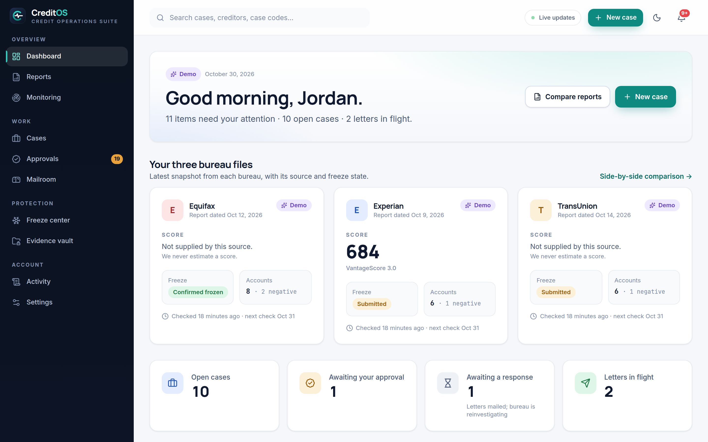
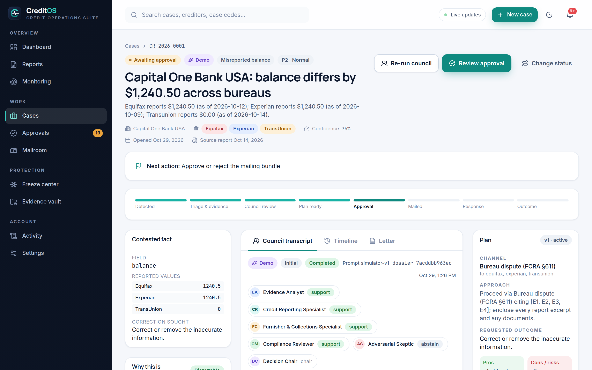
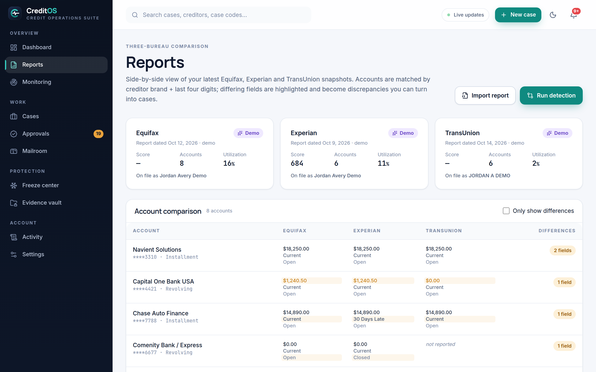
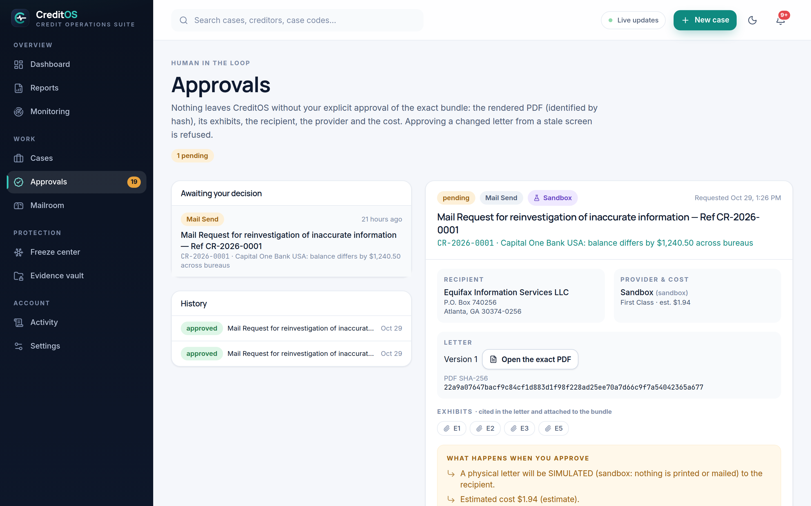
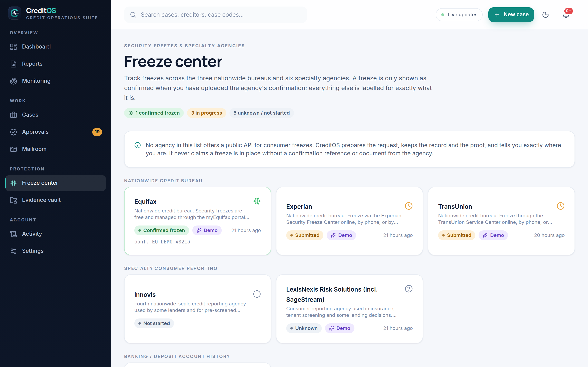
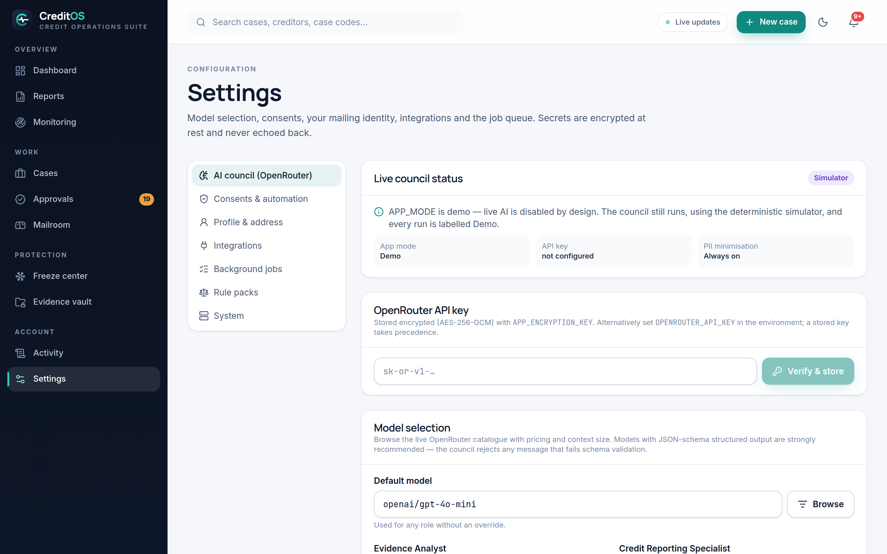
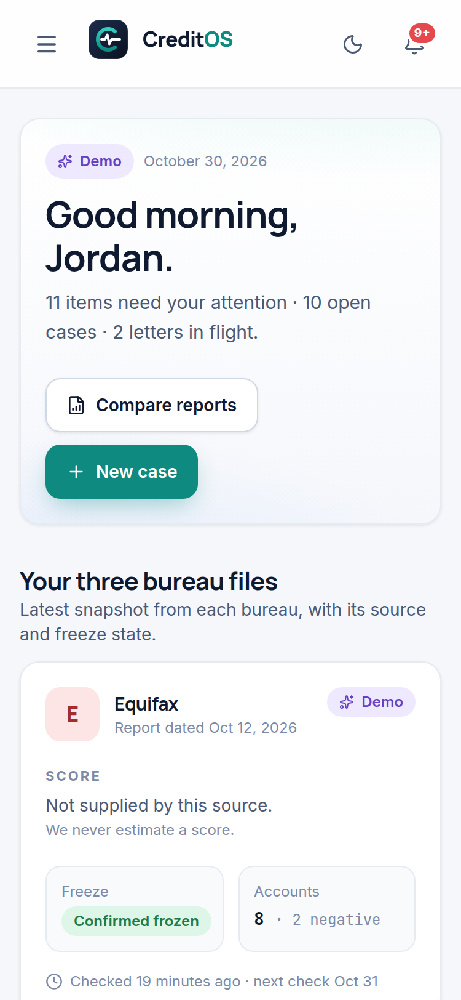

<p align="center">
  
</p>

<p align="center">
  <strong>CreditOS</strong> is a self-hosted, AI-assisted personal credit intelligence and dispute operations platform.<br />
  Three-bureau report comparison · evidence-driven rules · a real multi-agent council · approval-gated physical mail · an inbound mailroom · honest freeze tracking.
</p>

<p align="center">
  
  
  
  
  
  
</p>

---

## What it does

| Area | Summary |
| --- | --- |
| **Three-bureau reports** | Import Equifax, Experian and TransUnion reports (JSON import or synthetic demo data), preserve source facts and report dates, and compare matching tradelines without joining unrelated accounts. Scores are shown only when the source provided one. |
| **Monitoring** | Scheduled polling with visible last-check timestamps, deduplicated alerts, and reviewable tickets. No fake "real-time" claims. |
| **Rules engine** | An evidence-driven, explainable rule pack separates inaccuracies, identity theft, goodwill, furnisher disputes, collections questions and "needs more evidence". Every verdict lists evidence gaps, a legal basis and a *not legal advice* disclaimer. |
| **Case workspace** | A hero case page: contested fact and evidence on the left, the council transcript and factual timeline in the centre, the plan, illustrative response scenarios, correspondence and approvals on the right. |
| **Multi-agent council** | Six roles (evidence analyst, bureau specialist, furnisher/collections specialist, compliance reviewer, adversarial skeptic, decision chair) run three rounds — findings, critiques and replies, revised proposals — then cast recorded ballots. The chair is bound by hard gates (evidence, compliance, consent, fabrication check). Demo mode uses a deterministic simulator; live mode uses OpenRouter with structured outputs. |
| **Letters and approvals** | Versioned letter drafts, exact PDF rendering with SHA-256, an approval bundle that shows recipient, cost estimate, exhibits and consequences, and three explicit confirmations before anything is queued. |
| **Outbound mail** | Provider adapters (sandbox, PostGrid; DocuPost scaffold) with idempotent order creation, external order ids, signed webhooks and duplicate-callback suppression. |
| **Inbound mailroom** | Manual PDF/image upload today, connector architecture for scan providers. Text extraction, case matching, an unassigned triage inbox, response classification and automatic council reassessment. |
| **Freeze center** | Nine agencies (Equifax, Experian, TransUnion, Innovis, ChexSystems, LexisNexis, NCTUE, The Work Number, DataX) with guided requests, required evidence and a state machine that never marks a freeze confirmed without evidence. |
| **Operations** | Postgres-backed job queue with retries and dead-lettering, audit log, in-app notifications, server-sent events, encrypted secret storage, Demo/Test/Live labelling everywhere. |

> CreditOS is a personal operating tool, not legal advice. Dispute outcomes are never guaranteed, and the product never pretends a mock is live.

## Screenshots

| Dashboard | Case workspace (council) |
| --- | --- |
|  |  |

| Three-bureau reports | Approvals |
| --- | --- |
|  |  |

| Freeze center | Settings · OpenRouter model picker | Mobile |
| --- | --- | --- |
|  |  |  |

## Stack

- **Nuxt 4.6** (Vue 3.5, Nitro `node-server` preset, TypeScript strict) — single process serving UI, API, SSE and the background job worker.
- **Tailwind CSS 4** with a token-driven, light-first design system (`brand/tokens/creditos.tokens.json` → `app/assets/css/main.css`), dark theme as a first-class mirror, Manrope + Inter + JetBrains Mono self-hosted via Fontsource.
- **PostgreSQL 14+** via Drizzle ORM. The database is always external; migrations live in `server/db/migrations` and run on boot (`AUTO_MIGRATE=true`) or via `pnpm db:migrate`.
- **OpenRouter** for live model calls with a searchable model catalogue, per-role model selection, structured outputs, provider routing preferences and a per-run cost cap.
- **pdf-lib / unpdf** for letter rendering and text extraction, **file-type** for magic-byte validation.
- **vitest** for unit and scenario tests, **ESLint** (`@nuxt/eslint`) and `vue-tsc` for static checks.

Exact versions are pinned in `package.json` / `pnpm-lock.yaml` (Nuxt `4.6.3`, Vue `3.5.x`, Drizzle ORM `0.45.x`, Tailwind `4.x`).

## Quick start (local)

Requirements: Node 22+, pnpm 10 (`corepack enable`), and a reachable PostgreSQL 14+ database.

```bash
git clone https://github.com/zodyking/CreditOS.git
cd CreditOS
pnpm install
cp .env.example .env
# edit .env: DATABASE_URL, NUXT_SESSION_PASSWORD, APP_ENCRYPTION_KEY
pnpm dev
```

Open <http://localhost:3000>. In demo mode (`APP_MODE=demo`, `DEMO_SEED=true`) the database is migrated and seeded on first boot and you can sign in with:

```
demo@creditos.local / creditos-demo
```

Outside demo mode the first visit shows an owner-setup screen instead.

### Windows 11 (PowerShell)

```powershell
git clone https://github.com/zodyking/CreditOS.git
Set-Location CreditOS
corepack enable
pnpm install
Copy-Item .env.example .env
notepad .env          # set DATABASE_URL, NUXT_SESSION_PASSWORD, APP_ENCRYPTION_KEY
pnpm dev              # development server on http://localhost:3000
```

Production on Windows:

```powershell
pnpm build
$env:NODE_ENV = "production"
node .output\server\index.mjs
```

Run these from the project folder (any folder you own). Nothing depends on launching from `C:\Windows\System32`.

Generate secrets on any platform with Node:

```bash
node -e "console.log(require('crypto').randomBytes(48).toString('base64'))"   # NUXT_SESSION_PASSWORD
node -e "console.log(require('crypto').randomBytes(32).toString('base64'))"   # APP_ENCRYPTION_KEY
```

## Deploy with Dokploy (or plain Docker)

CreditOS ships a multi-stage `Dockerfile` (Node 22 Alpine, non-root user, health check) and a `docker-compose.yml` that treats PostgreSQL as an external service.

1. In Dokploy create a **Compose** application pointing at this repository (or a **Docker** application using the `Dockerfile`).
2. Provision PostgreSQL as a separate Dokploy database service (or use a managed instance) and copy its connection string.
3. Set environment variables in Dokploy's Environment panel. Un-prefixed names (`DATABASE_URL`) and `NUXT_`-prefixed names (`NUXT_DATABASE_URL`) are both accepted:

   | Variable | Required | Notes |
   | --- | --- | --- |
   | `DATABASE_URL` | yes | External Postgres connection string |
   | `NUXT_SESSION_PASSWORD` | yes | 32+ chars, signs/encrypts the session cookie |
   | `APP_ENCRYPTION_KEY` | yes | 32-byte key (base64/hex) for AES-256-GCM secret storage |
   | `APP_MODE` | no | `demo` (default) · `test` · `live` — see `INTEGRATIONS.md` |
   | `DATA_DIR` | no | Uploaded documents and PDFs (`/data` in the image; mount a volume) |
   | `OPENROUTER_API_KEY` | no | Can also be stored encrypted from Settings → AI |
   | `MAIL_OUTBOUND_PROVIDER`, `POSTGRID_API_KEY`, `MAIL_WEBHOOK_SECRET` | no | Outbound mail; sandbox by default |

4. Attach a persistent volume to `/data`.
5. Deploy. The container exposes port `3000` and reports readiness at `GET /api/health` (`200` when the database is reachable and migrations ran).

Plain Docker:

```bash
docker compose up -d --build
```

## Operating modes

| Mode | Council | Outbound mail | Data |
| --- | --- | --- | --- |
| `demo` | Deterministic simulator, labelled **Demo** | Sandbox only | Synthetic seed allowed |
| `test` | Live OpenRouter calls (if a key is stored and live runs are enabled) | Forced to sandbox even if a live provider is configured | Live imports allowed |
| `live` | Live OpenRouter calls | Configured provider (e.g. PostGrid) with explicit approval and consent | Live |

Every snapshot, council run, mail order and inbound item carries its own `mode` label, and the UI marks Demo/Sandbox/AI-generated content in Orchid so it can never be mistaken for a live result.

## Scripts

| Command | Purpose |
| --- | --- |
| `pnpm dev` | Development server with HMR |
| `pnpm build` / `pnpm start` | Production build / run `.output/server/index.mjs` |
| `pnpm db:migrate` | Apply SQL migrations (also automatic on boot when `AUTO_MIGRATE=true`) |
| `pnpm db:seed` | Seed the synthetic tri-bureau demo dataset |
| `pnpm db:reset` | Drop and recreate the schema (destructive) |
| `pnpm test` | vitest suite (state machines, detection, rules, council gates, mailroom, uploads, webhooks) |
| `pnpm lint` / `pnpm typecheck` | ESLint / `vue-tsc` |

## Repository layout

```
app/            Nuxt app: pages, layouts, components, composables, design tokens (CSS)
server/api      REST + SSE endpoints (Nitro)
server/domains  reports · monitoring · cases · rules · council · correspondence · mailroom · freezes · documents · jobs · settings · seed
server/db       Drizzle schema, client, SQL migrations
shared/         Constants and state machines shared by client and server
brand/          Brand kit: logos, social cards, design tokens, screenshots, brand README
tests/          vitest suites
scripts/        migrate / seed / reset CLIs
```

## Documentation

- [`INTEGRATIONS.md`](./INTEGRATIONS.md) — providers, consent, exactly which operations are implemented, and how to switch Demo/Test/Live.
- [`SECURITY.md`](./SECURITY.md) — security model, limitations and the production launch checklist.
- [`BUILD_STATUS.md`](./BUILD_STATUS.md) — every requirement marked Implemented / Simulated / Blocked on provider approval / Not implemented.
- [`brand/README.md`](./brand/README.md) — the brand kit.

## License

Copyright © zodyking. All rights reserved unless a license file is added to this repository.
